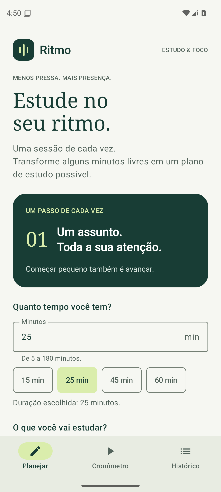

# Ritmo — Team 09

**Estude no seu ritmo. Uma sessão de cada vez.**

Projeto da disciplina Desenvolvimento de Softwares para Dispositivos Móveis (FALECT-CC-040), UNEMAT/AIA, 2026.2. Professor: Breno Felix de Sousa.

| Integrante | Matrícula |
| --- | --- |
| Fernando Henrique Cobianchi | 20220059497 |
| João Victor R. Peres | 20230079303 |

## Problema

Estudantes com pouco tempo livre costumam adiar o estudo porque não sabem como organizar uma sessão curta: quanto tempo usar, o que estudar e quando parar. O Ritmo transforma esses minutos em um plano simples de concentração e guarda o que já foi estudado.

## Público-alvo

Estudantes universitários, incluindo alunos da UNEMAT, que estudam em intervalos entre aulas, trabalho e outras atividades.

## Funcionalidades

| Função | Onde fica | SPEC |
| --- | --- | --- |
| Tela inicial com a proposta do app | Tela inicial | [SPEC-001](docs/specs/SPEC-001.md) |
| Duração digitada (5 a 180 min), com atalhos de 15, 25, 45 e 60 min | Tela inicial | [SPEC-002](docs/specs/SPEC-002.md), [SPEC-006](docs/specs/SPEC-006.md) |
| Navegação para Seu plano e volta com os dados preservados | Tela inicial ↔ Seu plano | [SPEC-003](docs/specs/SPEC-003.md) |
| Assunto (obrigatório) e objetivo (opcional), com validação | Tela inicial | [SPEC-004](docs/specs/SPEC-004.md) |
| Histórico salvo no aparelho, com totais, Excluir (com Desfazer) e Ver todas | Tela inicial | [SPEC-005](docs/specs/SPEC-005.md) |
| Meta da semana, ajustável de 30 em 30 min | Tela inicial | [SPEC-006](docs/specs/SPEC-006.md) |
| Cronômetro em regressiva (Começar, Pausar, Continuar, Recomeçar) | Seu plano | [SPEC-006](docs/specs/SPEC-006.md) |
| Aviso de fim da sessão por notificação, mesmo com o app fechado | Seu plano | [SPEC-006](docs/specs/SPEC-006.md) |
| Qualidade final: regressão completa, sem travamentos | — | [SPEC-007](docs/specs/SPEC-007.md) |



## Tecnologias

- Kotlin 2.1.20 e Jetpack Compose (Material 3)
- Navigation Compose 2.8.9
- Room 2.7.1 (histórico) e SharedPreferences (meta da semana)
- WorkManager 2.10.0 e notificações do Android (aviso de fim)
- Testes: JUnit, Compose UI Test, Espresso, UiAutomator e WorkManager Testing
- Android Gradle Plugin 8.9.1 e Gradle 8.11.1 (wrapper incluído)
- GitHub Actions para compilar, testar no emulador e gerar as capturas

## Como compilar e executar

1. Abra a pasta `app/`, que contém `settings.gradle.kts`, no Android Studio.
2. Instale SDK Platform 35, Build Tools 35.0.0 e Platform Tools pelo SDK Manager.
3. Use JDK 17 ou 21 e aguarde a sincronização do Gradle.
4. Execute o módulo `app` em um dispositivo ou emulador com Android 7.0 (API 24) ou superior.

A partir de `app/`, no PowerShell:

```powershell
.\gradlew.bat assembleDebug               # compila o APK
.\gradlew.bat testDebugUnitTest           # testes locais
.\gradlew.bat connectedDebugAndroidTest   # testes no aparelho/emulador
.\gradlew.bat lintDebug                   # análise estática
```

No Linux ou macOS, use `./gradlew` com os mesmos argumentos.

## Configuração necessária

- Nenhuma chave de API, conta ou internet: tudo roda no aparelho.
- O `local.properties` (caminho do SDK) é criado pelo Android Studio e não vai para o repositório.
- No Android 13 ou superior, o aviso de fim pede a permissão de notificação na primeira vez. Sem ela, o restante do app funciona normalmente.

## Limitações conhecidas

- O aviso de fim usa o WorkManager e pode atrasar alguns minutos no modo de economia de energia. Alarme exato exigiria a permissão especial `SCHEDULE_EXACT_ALARM`.
- Ao sair do plano, o cronômetro da tela é descartado. Um aviso já marcado continua valendo; marcar outro substitui o anterior.
- As sessões não podem ser editadas, só excluídas.
- Os dados ficam apenas no aparelho: não há login nem sincronização, e desinstalar o app apaga o histórico.
- O app está só em português.
- A validação foi feita em um Pixel 6 virtual com Android 15/API 35 (GitHub Actions). O lint não aponta erros; os avisos restantes são, em sua maioria, versões mais novas de bibliotecas, mantidas por compatibilidade com o Kotlin 2.1.20.

## Entregas

| Sprint | Documentação | Pull Request |
| --- | --- | --- |
| 00 | [Relatório](SPRINT-00.md) | [PR #19](https://github.com/brenofeliix/mobile-development-2026-2/pull/19) |
| 01 | [Relatório](SPRINT-01.md) | [PR #20](https://github.com/brenofeliix/mobile-development-2026-2/pull/20) |
| 02 | [Relatório](SPRINT-02.md) | [PR #21](https://github.com/brenofeliix/mobile-development-2026-2/pull/21) |
| 03 | [Relatório](SPRINT-03.md) | [PR #22](https://github.com/brenofeliix/mobile-development-2026-2/pull/22) |
| 04 | [Relatório](SPRINT-04.md) | [PR #41](https://github.com/brenofeliix/mobile-development-2026-2/pull/41) |
| 05 | [Relatório](SPRINT-05.md) | [PR #42](https://github.com/brenofeliix/mobile-development-2026-2/pull/42) |
| 06 | [Relatório](SPRINT-06.md) | [PR #45](https://github.com/brenofeliix/mobile-development-2026-2/pull/45) |
| 07 | [Relatório](SPRINT-07.md) | PR_07_LINK |

Cada relatório reúne a especificação, as decisões de implementação, os resultados de validação e as evidências do respectivo incremento. As especificações estão em `docs/specs/` e as capturas e os resultados de validação, em `evidence/`, organizados por sprint.

## Uso de IA

Sprints 00 a 03: utilizamos o Codex na especificação, geração de código, configuração, depuração, testes e documentação. Sprints 04 a 07: utilizamos o Claude (Claude Code) para as mesmas tarefas. Toda sugestão foi validada com compilação, testes locais e instrumentados no emulador e capturas de tela de execuções reais.

## Referências

- [Repositório da disciplina](https://github.com/brenofeliix/mobile-development-2026-2)
- Material de aula: *Sprint 01 — Product Definition & First Screen*, exemplo BCN Move.
- [Estado em Compose](https://developer.android.com/develop/ui/compose/state)
- [Navigation Compose](https://developer.android.com/develop/ui/compose/navigation)
- [Text fields em Compose](https://developer.android.com/develop/ui/compose/text/user-input)
- [Room](https://developer.android.com/training/data-storage/room)
- [WorkManager](https://developer.android.com/develop/background-work/background-tasks/persistent)
- [Permissão de notificação](https://developer.android.com/develop/ui/views/notifications/notification-permission)
