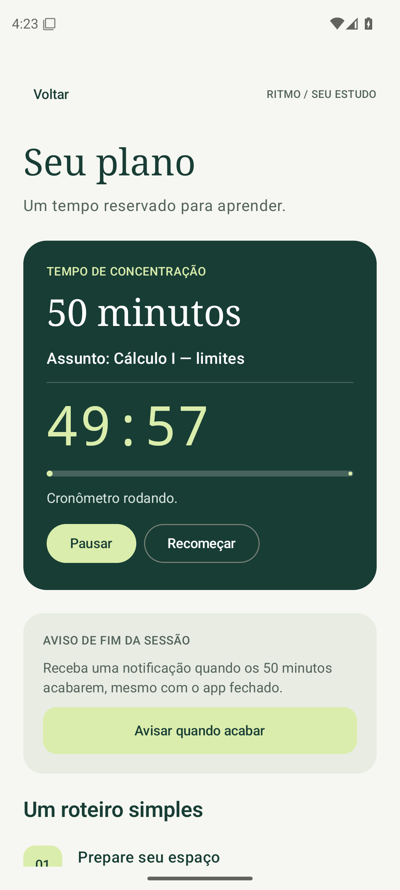
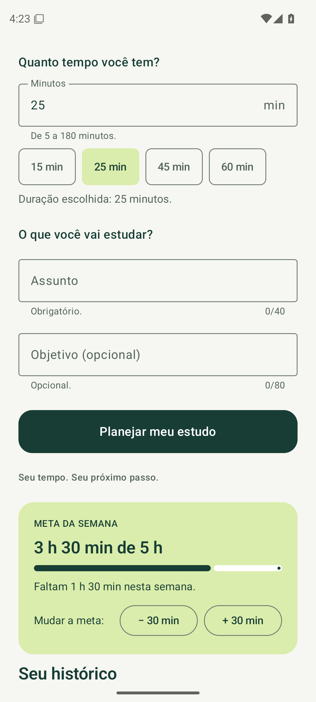
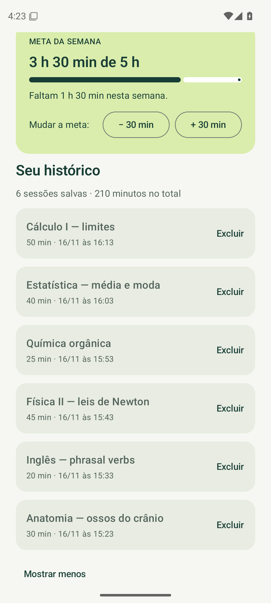
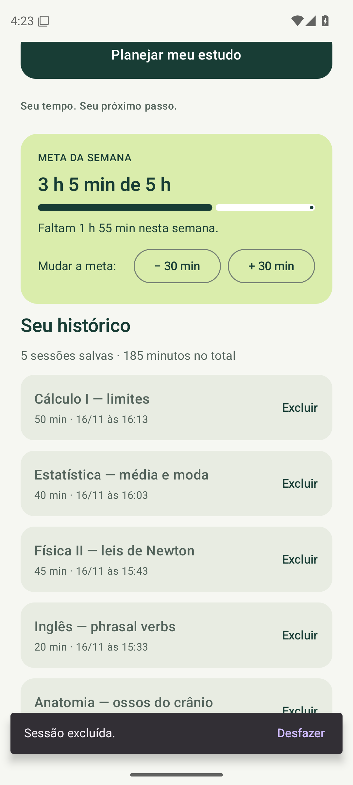
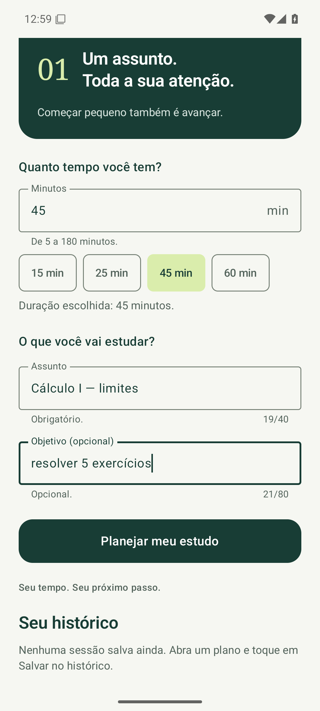
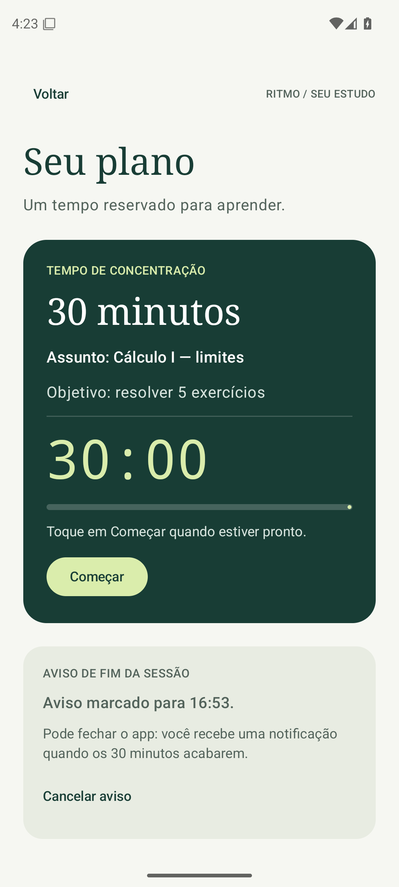
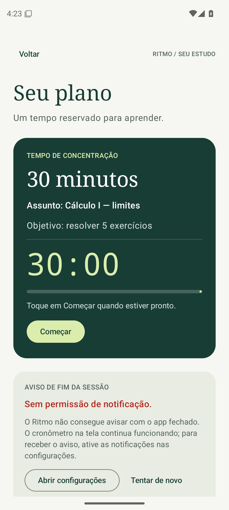
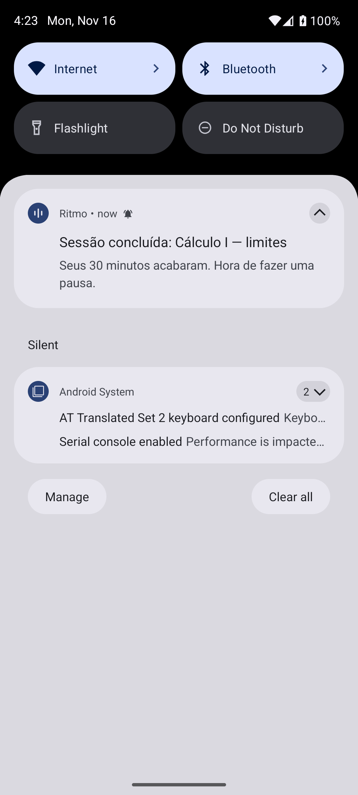

# SPRINT 06 — External or Device Integration

**Equipe 09:** Fernando Henrique Cobianchi e João Victor R. Peres.

## Objetivo e resultado

O Ritmo agora usa as **notificações do Android**. No plano, o botão **Avisar quando acabar** pede a permissão (Android 13+) e agenda um aviso para o fim da sessão. Quando o tempo termina, chega a notificação “Sessão concluída: <assunto>”, mesmo com o app fechado. Se a permissão for negada, o cartão explica o que acontece e oferece abrir as configurações.

Junto com a integração, a **duração passou a ser digitada** pelo estudante (de 5 a 180 minutos). Os botões 15, 25, 45 e 60 min continuam como atalhos. Antes, só era possível escolher 15, 25 ou 45, o que não refletia o tempo livre real de cada pessoa e tornava o aviso de fim pouco útil.

## Especificação

[SPEC-006](docs/specs/SPEC-006.md). A SPEC define o recurso usado, por que o produto precisa dele, o que o app envia e recebe, o que pode falhar e os estados da interface.

## Integração escolhida e relevância

| Item | Resposta |
| --- | --- |
| Recurso | Notificações do Android, agendadas pelo **WorkManager** |
| Por que no Ritmo | O app não tem cronômetro na tela; o aviso deixa o estudante concentrado sem olhar o relógio |
| Permissão | `POST_NOTIFICATIONS`, pedida em tempo de execução só no Android 13+ |
| Serviço externo | Nenhum: tudo acontece no aparelho, sem rede e sem chaves |

## Fluxo

1. Em Seu plano, o toque em **Avisar quando acabar** (`ui/ReminderCard.kt`) verifica `SessionNotifier.canNotify`.
2. Sem permissão no Android 13+, o app abre a janela do sistema com `rememberLauncherForActivityResult(RequestPermission())`. A resposta chega depois, em um callback (operação assíncrona).
3. Com permissão, `SessionReminder.schedule` registra no WorkManager um `OneTimeWorkRequest` com atraso de N minutos e nome único `fim-da-sessao` (um aviso por vez; agendar de novo substitui o anterior). A tela mostra “Aviso marcado para HH:mm.”.
4. O WorkManager guarda o agendamento e, no fim do tempo, executa `SessionEndWorker` em segundo plano, mesmo com o app fechado.
5. O Worker chama `SessionNotifier.show`, que confere a permissão de novo, cria o canal “Fim da sessão” e publica a notificação. Tocar nela abre o Ritmo.

## Estados da interface

| Estado | Quando | O que aparece |
| --- | --- | --- |
| Sem aviso | Ao abrir o plano | Explicação e botão Avisar quando acabar |
| Aviso marcado (sucesso) | Permissão concedida | “Aviso marcado para HH:mm.” e Cancelar aviso |
| Sem permissão (alternativo) | Permissão negada ou notificações desligadas | “Sem permissão de notificação.”, explicação, Abrir configurações e Tentar de novo |

## Tratamento de falhas

- **Permissão negada:** nada é agendado; o plano continua utilizável e o cartão mostra como resolver.
- **Notificações desligadas nas configurações:** tratado como sem permissão (`areNotificationsEnabled`).
- **Permissão retirada depois do agendamento:** o Worker confere a permissão antes de mostrar; sem ela, termina sem erro e sem notificação.
- **Modo de economia de energia:** o WorkManager pode atrasar o aviso em alguns minutos. Alarme exato exigiria outra permissão especial (`SCHEDULE_EXACT_ALARM`) e ficou fora do escopo.

## Privacidade e segurança

Nenhum dado sai do aparelho. A notificação mostra apenas o assunto e a duração digitados pelo próprio estudante. Não há chaves, tokens ou senhas no repositório. O `PendingIntent` da notificação usa `FLAG_IMMUTABLE`.

## Duração digitada

| Regra | Condição de erro | Mensagem | Implementação |
| --- | --- | --- | --- |
| VR-05a | Campo vazio | Informe quantos minutos você vai estudar. | `SessionRules.minutesError` |
| VR-05b | Menos de 5 | Use pelo menos 5 minutos. | `SessionRules.minutesError` |
| VR-05c | Mais de 180 | Use no máximo 180 minutos. | `SessionRules.minutesError` |

O campo só aceita dígitos (até 3). A coluna `minutes` do histórico já era um inteiro, então o banco não mudou.

## Melhorias de uso

Depois da integração, quatro pontos que faltavam no uso diário entraram na mesma sprint:

| Melhoria | O que faz | Implementação |
| --- | --- | --- |
| Cronômetro na tela | Contagem regressiva no cartão do plano, com Começar, Pausar, Continuar e Recomeçar. Guarda o horário de término, então continua certo com o app em segundo plano e após girar a tela. | `model/StudyTimer.kt`, `ui/PlanScreen.kt` |
| Aviso junto com o cronômetro | Com o aviso ligado, pausar o cronômetro pausa o aviso (“Aviso pausado junto com o cronômetro.”); continuar marca de novo para o fim do tempo que falta. | `PlanScreen.syncReminder`, `SessionReminder.schedule(delayMs)` |
| Meta da semana | Soma os minutos salvos desde segunda-feira e mostra o progresso até a meta (padrão 5 h, ajustável de 30 em 30 min, guardada nas preferências do app). | `model/WeeklyGoal.kt`, `data/GoalStore.kt`, `SessionDao.observeMinutesSince` |
| Excluir e ver todas | Cada sessão tem Excluir; a mensagem “Sessão excluída.” oferece Desfazer. O histórico mostra as 5 mais recentes e Ver todas as N sessões lista o resto. | `SessionDao.delete`, `SessionRepository.restore`, `ui/HistorySection.kt` |

Também foi corrigida a causa do toque duplo: a tela do plano ignora toques enquanto a animação de entrada não termina (`Lifecycle.State.RESUMED`), então o segundo toque em Planejar meu estudo não aciona nada no plano, qualquer que seja o botão naquela posição.

## Validação

Compilação aprovada. **31 testes instrumentados** aprovados no emulador, sem falhas: `ReminderTest` 4 (um deles confere que o aviso pausa e volta com o cronômetro), `TimerTest` 3 (novo), `HistoryTest` 7 (exclusão com Desfazer, meta da semana e Ver todas), `DurationTest` 5 (reescrito para a duração digitada) e os das sprints anteriores. Também passaram **17 testes locais**: 9 das regras do formulário, 5 do cronômetro (`StudyTimerTest`) e 3 da meta da semana (`WeeklyGoalTest`). [Resultados por critério](evidence/sprint-06/validation.md) e logs em `evidence/sprint-06/`.

**Dois cenários com a janela real do sistema:** antes de cada passo, o script retira a permissão do app. No passo `notificationDenied`, o teste toca em **Não permitir**, e o cartão mostra o estado alternativo. No passo `notificationAllowed`, o teste toca em **Permitir**, e o aviso é marcado para 30 minutos depois. Em seguida, o `SessionEndWorker` é executado sem esperar os 30 minutos, e a notificação aparece na gaveta.

Um ajuste veio da validação: o cartão do aviso ficava na mesma altura do botão Planejar meu estudo. Por isso, um toque duplo abria a janela de permissão sem querer. O cartão foi movido para logo abaixo do tempo da sessão.

## Uso de IA

| Item | Resposta |
| --- | --- |
| LLM/tool used | Claude (Claude Code) |
| Task supported by the LLM | Escolha da integração, fluxo de permissão, agendamento com WorkManager, campo de duração, cronômetro, meta da semana, exclusão de sessões, testes, automação das evidências e documentação |
| Main suggestion received | Usar notificação agendada pelo WorkManager em vez de cronômetro na tela; conferir a permissão também na hora do aviso; nome único com `REPLACE` para manter um aviso por vez |
| What the team changed manually | A duração deixou de ser fixa (15, 25 ou 45) e passou a ser digitada, com os valores fixos como atalhos; a equipe pediu o cronômetro na tela, a meta da semana, a exclusão de sessões e o Ver todas |
| How the result was validated | Testes locais e instrumentados no emulador e capturas com a janela real de permissão do sistema (negar e permitir) |

## Entrega

Branch: `team-09/sprint-06`. [Pull Request #45](https://github.com/brenofeliix/mobile-development-2026-2/pull/45), com destino à `main` do repositório da disciplina.

## Definition of Done

- [x] SPEC-006 completa.
- [x] Uma integração relevante funcionando.
- [x] Estados de sucesso e alternativo tratados.
- [x] Nenhum segredo no repositório.
- [x] Evidências e uso de IA documentados.
- [x] PR enviado.
