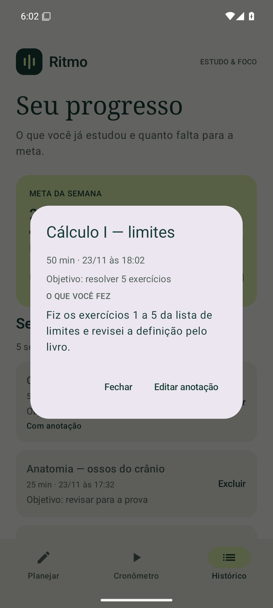

# SPRINT 07 — Final Integration, Quality & Delivery

**Equipe 09:** Fernando Henrique Cobianchi e João Victor R. Peres.

## Objetivo e resultado

Esta é a entrega final do Ritmo. A sprint começou como revisão de qualidade do app inteiro: um teste de regressão percorre o app em uma única jornada, e a abertura limpa, o Voltar e o log de travamentos são conferidos no emulador.

Em seguida, a equipe instalou o APK em um celular real e usou o app no dia a dia, o que revelou três falhas de uso que os testes automáticos não pegavam, porque o comportamento estava como especificado:

1. **Nenhum alarme no fim do tempo.** O cronômetro chegava a zero em silêncio, e o aviso por notificação só existia se o estudante lembrasse de ligá-lo.
2. **Uma tela só.** Planejar, cronometrar e ver o histórico ficavam na mesma tela comprida, sem como alternar entre eles.
3. **O cronômetro parava ao sair do plano.** Voltar para a tela inicial descartava a contagem.

As três foram corrigidas nesta sprint. A equipe também pediu um lugar para registrar **o que foi estudado** em cada sessão. Resultado final: app com três abas, cronômetro que só para no Pausar, alarme automático, contagem na notificação e anotações no histórico, com todos os testes aprovados.

## Especificação

[SPEC-007](docs/specs/SPEC-007.md). Define os requisitos de qualidade final (FR-01 a FR-08), as correções que vieram do uso no celular (FR-09 a FR-12), a anotação (FR-13), o roteiro de regressão RS-01 a RS-09 e a rastreabilidade de cada requisito até o código e a evidência.

## Revisão das especificações

| Specification | Main feature | Current status | Evidence |
| --- | --- | --- | --- |
| SPEC-001 | Tela inicial com a proposta do app e a ação principal | PASS | `WelcomeTest`; RS-01 e RS-02; [final-home.png](evidence/sprint-07/final-home.png) |
| SPEC-002 | Escolha da duração com resposta imediata no resumo | PASS | `DurationTest`; RS-03 |
| SPEC-003 | Navegação para o plano e volta com a escolha preservada | PASS (agora pelas abas) | `NavigationTest`; RS-05 e RS-08; [clean-launch.txt](evidence/sprint-07/clean-launch.txt) |
| SPEC-004 | Assunto e objetivo com validação | PASS | `FormTest`, `SessionRulesTest`; RS-04 |
| SPEC-005 | Histórico salvo no aparelho (Room) | PASS | `HistoryTest`; RS-06; migração 1 → 2 em `NotesTest`; [final-history.png](evidence/sprint-07/final-history.png) |
| SPEC-006 | Duração digitada, cronômetro, meta da semana e aviso de fim | PASS, com uma mudança: o aviso por WorkManager, que precisava ser ligado à mão, virou o alarme automático da SPEC-007 | `TimerTest`, `StudyTimerTest`, `WeeklyGoalTest`, `AlarmTest`; RS-07; [final-feature.png](evidence/sprint-07/final-feature.png) |
| SPEC-007 | Final quality | PASS | `FinalRegressionTest`, `AlarmTest`, `NotesTest`; [crash-log.txt](evidence/sprint-07/crash-log.txt) vazio; [final-validation.md](evidence/sprint-07/final-validation.md) |

Nenhuma especificação ficou em FAIL. As limitações conhecidas estão no [README](README.md#limitações-conhecidas).

## Teste de regressão

O teste instrumentado `FinalRegressionTest.completeJourneyFromLaunch` começa sem dados e segue, em uma única jornada, os nove passos pedidos na sprint:

| Passo | O que foi feito | Resultado |
| --- | --- | --- |
| 1. App abre | Abertura a frio com os dados apagados (`pm clear` + `am start -W`) | PASS: `Status: ok`, aba Planejar em primeiro plano |
| 2. Tela principal utilizável | Marca, formulário, Planejar meu estudo, as três abas e o histórico vazio com a dica | PASS |
| 3. Navegação | Planejar meu estudo abre a aba Cronômetro com 40 min, assunto e objetivo; as abas alternam | PASS |
| 4. Estado/interação | Atalho 45 min marcado e “Duração escolhida: 45 minutos.” na hora | PASS |
| 5. Validação | Minutos “2” e assunto vazio: duas mensagens e o plano não abre | PASS |
| 6. Persistência | Salvar no histórico abre a aba Histórico com “1 sessão salva · 40 minutos no total” e meta “40 min de 5 h”; continua após recriar a tela | PASS |
| 7. Integração | Começar marca o alarme sozinho; trocar de aba não para o cronômetro; Pausar desmarca o alarme e Continuar marca de novo | PASS |
| 8. Voltar | Na aba Cronômetro, o Voltar do Android leva a Planejar com os dados preservados e o cronômetro rodando; em Planejar, volta para o launcher | PASS |
| 9. Sem travamento | Jornada sem exceção; log de travamentos do Android vazio em toda a execução | PASS |

## Uso em celular real e correções

| Problema encontrado no celular | Correção | Onde está no código | Teste / evidência |
| --- | --- | --- | --- |
| Nenhum alarme quando o tempo acaba | Começar marca o alarme no horário exato (`AlarmManager`); no fim, o som de alarme se repete por até 1 minuto ou até tocar em Parar | `timer/AlarmScheduler.kt`, `timer/TimerNotifications.kt` | `AlarmTest`; [final-alarm.png](evidence/sprint-07/final-alarm.png) |
| Uma tela só | Barra inferior com as abas Planejar, Cronômetro e Histórico | `ui/RitmoApp.kt`, `ui/HistoryScreen.kt` | `NavigationTest`; [final-home.png](evidence/sprint-07/final-home.png) |
| Cronômetro parava ao sair do plano | O cronômetro passou a viver fora da tela, salvo no aparelho (`SessionClock`): continua ao trocar de aba ou fechar o app e só para no Pausar | `timer/SessionClock.kt` | `TimerTest`; [final-timer-after-restart.png](evidence/sprint-07/final-timer-after-restart.png) |
| (pedido da equipe) Ver o tempo sem abrir o app | Notificação fixa com a contagem regressiva e Pausar/Continuar | `timer/TimerNotifications.kt` | `AlarmTest`; [final-notification-countdown.png](evidence/sprint-07/final-notification-countdown.png) |
| (pedido da equipe) Registrar o que foi estudado | Tocar na sessão abre os detalhes; Anotar abre uma janela para escrever o que foi feito. Na lista, só a marca “Com anotação”, para não ocupar espaço | `ui/HistorySection.kt`, `data/RitmoDatabase.kt` (migração 1 → 2) | `NotesTest`; [final-notes.png](evidence/sprint-07/final-notes.png) |

Outras correções da revisão:

- **Virada da semana:** o início da semana da meta era calculado uma vez só; com o app aberto de domingo para segunda, a meta continuava somando a semana anterior. Agora é recalculado a cada atualização da tela (`ui/RitmoApp.kt`).
- **Aba do cronômetro rolada:** ao planejar uma sessão nova, a aba Cronômetro abria na rolagem da última visita; agora abre no topo.
- **Lint:** de 21 para 15 avisos, com 0 erros (`SharedPreferences.edit { }` e `String.toUri()` do core-ktx; o aviso `ObsoleteSdkInt` saiu junto com o cartão antigo).
- **Validação no emulador:** em algumas execuções, uma janela do sistema ficava com o foco e derrubava testes sem relação com o app. O script passou a esperar o Android terminar de ligar e a registrar a janela em foco (`.github/scripts/emulator.sh`, fora da pasta da equipe).

Revisão de usabilidade: os termos são os mesmos em todas as telas (sessão, plano, histórico, alarme); toda ação tem retorno visível (mensagens de erro, “Sessão salva no histórico.”, “Sessão excluída.” com Desfazer, “Alarme marcado para HH:mm.”); as abas vazias explicam o que fazer; os botões principais têm 48 dp ou mais; e os botões de excluir têm descrição para leitor de tela. O visual das sprints anteriores foi mantido.

## Repositório

A pasta da equipe não contém `.idea/`, `.gradle/`, `build/`, `local.properties`, APKs, chaves, tokens ou senhas (bloqueados pelo `.gitignore`). O Gradle Wrapper está incluído.

## Validação

Compilação aprovada. **40 testes instrumentados** e **17 testes locais** aprovados, sem falhas; 6 passos de captura aprovados; log de travamentos vazio; lint com 0 erros. [Resultados completos](evidence/sprint-07/final-validation.md).

## Demonstração final

| Integrante | Parte que demonstra | Problema → objetivo → SPEC → implementação → validação → evidência |
| --- | --- | --- |
| Fernando Henrique Cobianchi | Abas, planejamento e histórico | Estudante não sabe por onde começar e esquece o que fez → planejar e registrar → SPEC-001 a 005 e FR-09/FR-13 → `WelcomeScreen`, `NavHost` em `RitmoApp`, Room (`data/`) → `NavigationTest`, `HistoryTest`, `NotesTest` → `final-home.png`, `final-history.png`, `final-notes.png` |
| João Victor R. Peres | Cronômetro, alarme e notificação | Perder a noção do tempo e de quando parar → cronômetro que não para e alarme no fim → SPEC-006 e FR-10 a FR-12 → `SessionClock`, `AlarmScheduler`, `TimerNotifications` → `TimerTest`, `AlarmTest` → `final-feature.png`, `final-alarm.png` |

## Uso de IA

| Item | Team response |
| --- | --- |
| LLM/tool used | Claude (Claude Code) |
| Task supported by the LLM | Roteiro de regressão a partir das SPECs, teste da jornada completa, implementação das correções pedidas pela equipe (abas, cronômetro fora da tela, alarme, notificação e anotações), testes automáticos, capturas no emulador e primeira versão dos textos |
| Main suggestion received | Guardar o cronômetro fora da tela (horário de término salvo no aparelho) para ele sobreviver ao app fechado; usar o AlarmManager em vez do WorkManager para o alarme tocar na hora exata; migração do banco para não perder o histórico de quem já usava o app |
| What the team changed manually | A equipe instalou o app no celular, usou e encontrou as três falhas (sem alarme, uma tela só, cronômetro parando); definiu como o alarme deveria funcionar (tocar por até 1 minuto ou até tocar em Parar) e pediu a contagem na notificação; propôs a anotação do que foi estudado e decidiu o formato (lista compacta, detalhes ao tocar e janela separada para editar); testou de novo no celular a versão corrigida |
| How the result was validated | Compilação, testes locais e instrumentados no emulador Pixel 6 (Android 15), capturas de execuções reais, log de travamentos vazio e uso do app no celular de um integrante antes e depois das correções |

## Entrega

Branch: `team-09/sprint-07`. [Pull Request #58](https://github.com/brenofeliix/mobile-development-2026-2/pull/58), com destino à `main` do repositório da disciplina.

## Definition of Done

- [x] SPEC-007 completa.
- [x] Teste de regressão executado.
- [x] Problemas críticos corrigidos ou documentados.
- [x] README completo.
- [x] Evidências finais reais e completas.
- [x] Repositório limpo.
- [x] Uso de IA documentado.
- [x] PR final enviado até 23/11/2026.
