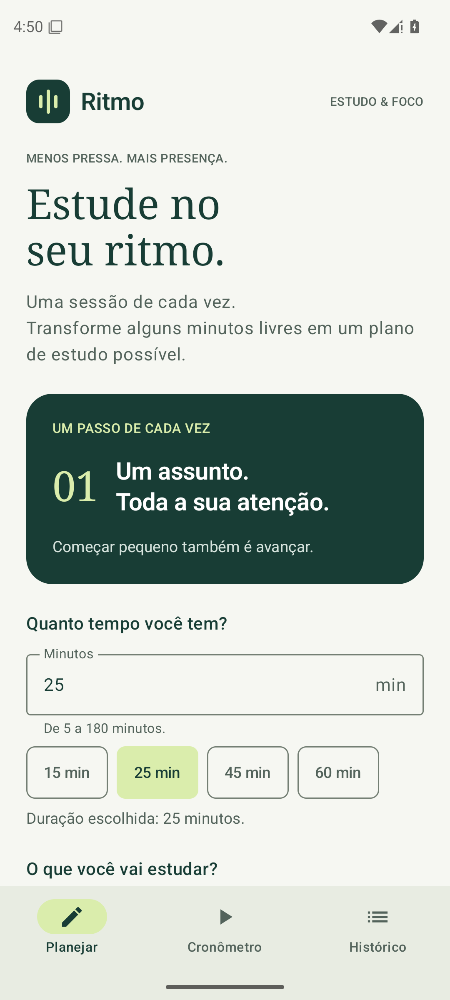
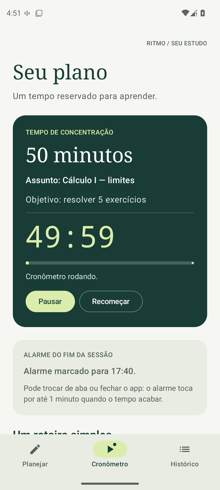
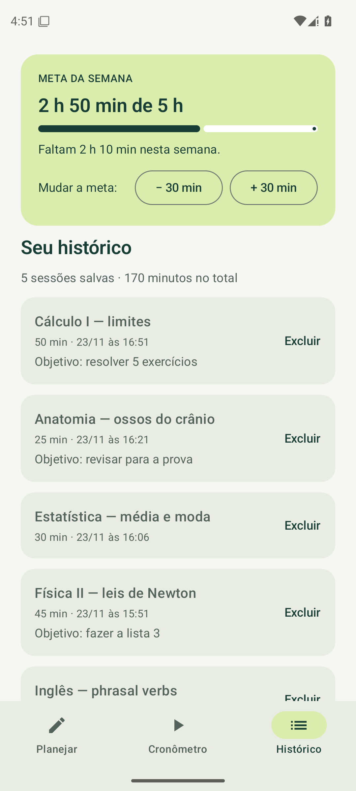

# SPRINT 07 — Final Integration, Quality & Delivery

**Equipe 09:** Fernando Henrique Cobianchi e João Victor R. Peres.

## Objetivo e resultado

Esta é a entrega final do Ritmo. A sprint não trouxe função nova: o objetivo foi conferir o app inteiro funcionando em conjunto, corrigir o que apareceu na revisão e fechar a documentação.

Resultado: as seis especificações anteriores continuam aprovadas; um teste de regressão novo percorre o app completo em uma única jornada; a abertura limpa, o Voltar na tela raiz e o log de travamentos foram conferidos no emulador; e o README passou a reunir problema, público, funcionalidades, tecnologias, execução, configuração e limitações.

## Especificação

[SPEC-007](docs/specs/SPEC-007.md). Define os requisitos de qualidade final (abertura, navegação, validação, persistência, estados da integração, ausência de travamentos, consistência visual e repositório limpo), o roteiro de regressão RS-01 a RS-09 e a rastreabilidade de cada requisito até o código e a evidência.

## Revisão das especificações

| Specification | Main feature | Current status | Evidence |
| --- | --- | --- | --- |
| SPEC-001 | Tela inicial com a proposta do app e a ação principal | PASS | `WelcomeTest`; RS-01 e RS-02; [final-home.png](evidence/sprint-07/final-home.png) |
| SPEC-002 | Escolha da duração com resposta imediata no resumo | PASS | `DurationTest`; RS-03 (atalho 45 min marcado e resumo atualizado) |
| SPEC-003 | Navegação para Seu plano e volta com a escolha preservada | PASS | `NavigationTest`; RS-05 e RS-08; [clean-launch.txt](evidence/sprint-07/clean-launch.txt) |
| SPEC-004 | Assunto e objetivo com validação | PASS | `FormTest`, `SessionRulesTest`; RS-04 |
| SPEC-005 | Histórico salvo no aparelho (Room) | PASS | `HistoryTest`; passos `Sprint05Evidence` (app fechado e aberto de novo); RS-06; [final-history.png](evidence/sprint-07/final-history.png) |
| SPEC-006 | Aviso de fim por notificação, duração digitada, cronômetro e meta da semana | PASS | `ReminderTest`, `TimerTest`, `StudyTimerTest`, `WeeklyGoalTest`; passos `Sprint06Evidence` (negar e permitir na janela real); RS-07; [final-feature.png](evidence/sprint-07/final-feature.png) |
| SPEC-007 | Final quality | PASS | `FinalRegressionTest`; [crash-log.txt](evidence/sprint-07/crash-log.txt) vazio; [final-validation.md](evidence/sprint-07/final-validation.md) |

Nenhuma especificação ficou em FAIL. As limitações conhecidas estão no [README](README.md#limitações-conhecidas).

## Teste de regressão

O teste instrumentado `FinalRegressionTest.completeJourneyFromLaunch` começa com o banco vazio e segue, em uma única jornada, os nove passos pedidos na sprint:

| Passo | O que foi feito | Resultado |
| --- | --- | --- |
| 1. App abre | Abertura a frio com os dados apagados (`pm clear` + `am start -W`) | PASS: `Status: ok`, tela inicial em primeiro plano |
| 2. Tela principal utilizável | Marca, formulário, Planejar meu estudo e histórico vazio com a dica | PASS |
| 3. Navegação | Planejar meu estudo abre Seu plano com 40 min, assunto e objetivo | PASS |
| 4. Estado/interação | Atalho 45 min marcado e “Duração escolhida: 45 minutos.” na hora | PASS |
| 5. Validação | Minutos “2” e assunto vazio: duas mensagens e o plano não abre | PASS |
| 6. Persistência | Salvar no histórico: “1 sessão salva · 40 minutos no total”, meta “40 min de 5 h”; continua após recriar a tela | PASS |
| 7. Integração | Começar, Avisar quando acabar (marcado), Pausar (aviso pausado), Continuar (marcado de novo), Cancelar aviso; permissão negada testada em `Sprint06Evidence` | PASS |
| 8. Voltar | No plano, o Voltar do Android retorna à tela inicial com duração e assunto preservados; na tela inicial, volta para o launcher do Android | PASS |
| 9. Sem travamento | Jornada sem exceção; log de travamentos do Android vazio em toda a execução | PASS |

Além dele, foram executados de novo todos os testes das sprints anteriores e os 11 passos de evidência das sprints 04 a 07, cada um em um processo novo do app.

## Correções e melhorias desta sprint

| Item | Antes | Depois | Arquivo |
| --- | --- | --- | --- |
| Virada da semana | O início da semana da meta era calculado uma vez só; com o app aberto de domingo para segunda, a meta continuava somando a semana anterior | Recalculado a cada atualização da tela; a consulta ao banco só é refeita quando a semana muda | `ui/RitmoApp.kt` |
| Avisos do lint | 21 avisos | 18 avisos: `SharedPreferences.edit { }` e `String.toUri()` do core-ktx | `data/GoalStore.kt`, `ui/ReminderCard.kt` |
| Validação no emulador | Em algumas execuções, uma janela do sistema ficava com o foco e derrubava testes sem relação com o app | O script espera o Android terminar de ligar, fecha janelas do sistema e registra a janela em foco antes dos testes | `.github/scripts/emulator.sh` (fora da pasta da equipe) |

Revisão de usabilidade: os termos são os mesmos em todas as telas (sessão, plano, histórico, aviso); toda ação tem retorno visível (mensagens de erro, “Sessão salva no histórico.”, “Sessão excluída.” com Desfazer, “Aviso marcado para HH:mm.”); o histórico vazio explica o que fazer; os botões principais têm 48 dp ou mais de altura; e o botão Excluir de cada sessão tem descrição para leitor de tela (“Excluir <assunto>”). Nenhuma tela foi redesenhada.

## Repositório

A pasta da equipe não contém `.idea/`, `.gradle/`, `build/`, `local.properties`, APKs, chaves, tokens ou senhas (bloqueados pelo `.gitignore`). O Gradle Wrapper está incluído.

## Validação

Compilação aprovada. **32 testes instrumentados** aprovados no emulador, sem falhas (31 das sprints anteriores + `FinalRegressionTest`), e **17 testes locais** aprovados. Lint com 0 erros. [Resultados completos](evidence/sprint-07/final-validation.md).

## Demonstração final

| Integrante | Parte que demonstra | Problema → objetivo → SPEC → implementação → validação → evidência |
| --- | --- | --- |
| Fernando Henrique Cobianchi | Tela inicial, duração e navegação | Estudante não sabe por onde começar → planejar uma sessão curta → SPEC-001 a 003 → `WelcomeScreen`, `DurationPicker`, `NavHost` em `RitmoApp` → `WelcomeTest`, `NavigationTest` → `final-home.png` |
| João Victor R. Peres | Formulário, histórico, aviso e cronômetro | Esquecer o que estudou e quando parar → registrar e avisar → SPEC-004 a 006 → `SessionRules`, Room (`data/`), `SessionReminder`, `PlanScreen` → `FormTest`, `HistoryTest`, `ReminderTest` → `final-feature.png`, `final-history.png` |

## Uso de IA

| Item | Team response |
| --- | --- |
| LLM/tool used | Claude (Claude Code) |
| Task supported by the LLM | Sugerir o roteiro de regressão a partir das SPECs, escrever o teste da jornada completa e os passos de captura, revisar o código em busca de defeitos de baixo risco e redigir a primeira versão da SPEC-007, do relatório e do README |
| Main suggestion received | Juntar os nove passos da sprint em um único teste instrumentado; registrar a abertura limpa e o log de travamentos pelo `adb`; recalcular o início da semana da meta para ela virar na segunda-feira |
| What the team changed manually | A equipe definiu as funções do produto ao longo das sprints (duração digitada, cronômetro, meta da semana, excluir sessões), decidiu que a última sprint seria só de qualidade e documentação, revisou o relatório e o README e instalou o APK em um celular real para usar o app fora do emulador |
| How the result was validated | Compilação, 17 testes locais, 32 testes instrumentados e 11 passos de captura no emulador Pixel 6 (Android 15), log de travamentos vazio e uso do app no celular de um integrante |

## Entrega

Branch: `team-09/sprint-07`. PR_07_LINK, com destino à `main` do repositório da disciplina.

## Definition of Done

- [x] SPEC-007 completa.
- [x] Teste de regressão executado.
- [x] Problemas críticos corrigidos ou documentados.
- [x] README completo.
- [x] Evidências finais reais e completas.
- [x] Repositório limpo.
- [x] Uso de IA documentado.
- [x] PR final enviado até 23/11/2026.
