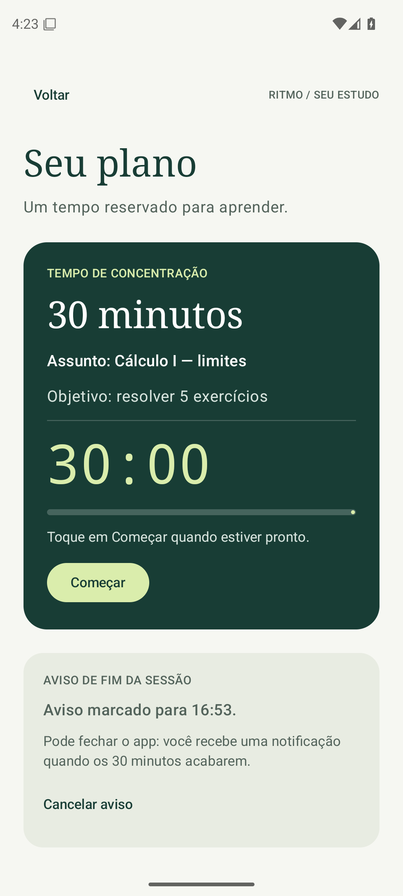
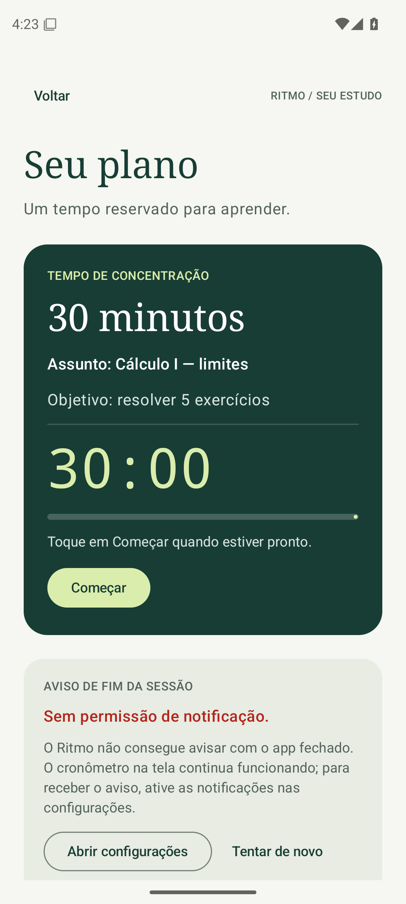
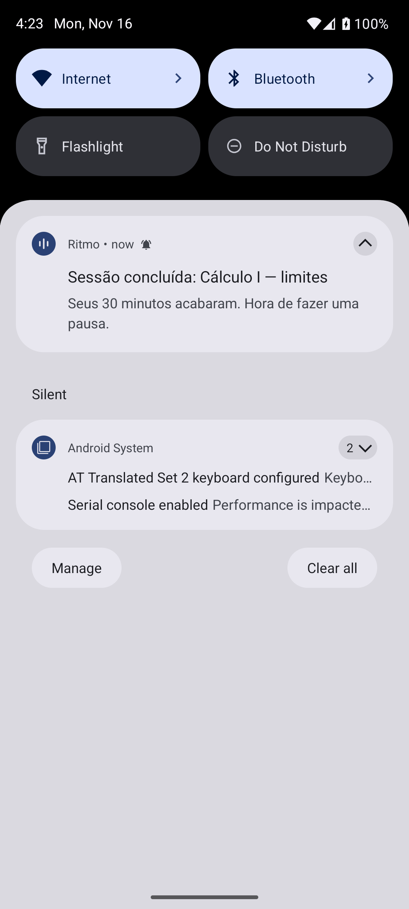

# SPEC-006 — Aviso de fim da sessão por notificação

> **Team:** Team 09<br>
> **Sprint:** Sprint 06<br>
> **Status:** Validada<br>
> **Related Sprint:** [SPRINT-06.md](../../SPRINT-06.md)

## 1. Context

**Problema:** O plano diz por quanto tempo estudar, mas o Ritmo não mostra cronômetro. Para saber quando parar, o estudante precisava olhar o relógio, o que interrompe a concentração. Além disso, a duração só podia ser 15, 25 ou 45 minutos, e quem tinha 30, 50 ou 90 minutos livres não conseguia planejar o tempo real.<br>
**Usuários:** Estudantes universitários, incluindo alunos da UNEMAT.<br>
**Contexto:** Depois de abrir o plano, o estudante guarda o celular e começa a estudar. O próprio aparelho avisa quando o tempo acaba, mesmo com o app fechado.

## 2. Objective

Integrar o app às **notificações do Android**: ao tocar em Avisar quando acabar, pedir a permissão quando necessário, agendar o aviso para o fim da sessão e mostrar na tela o resultado (aviso marcado ou permissão negada). A duração passa a ser digitada pelo estudante, de 5 a 180 minutos.

## 3. User Scenario

**Dado** que o estudante digitou 30 minutos e o assunto “Cálculo I — limites”,<br>
**quando** abre o plano, toca em Avisar quando acabar e permite as notificações,<br>
**então** vê “Aviso marcado para HH:mm.” e, 30 minutos depois, recebe a notificação “Sessão concluída: Cálculo I — limites”.

**Dado** o mesmo plano,<br>
**quando** o estudante toca em Não permitir na janela do sistema,<br>
**então** vê “Sem permissão de notificação.”, com a explicação e os botões Abrir configurações e Tentar de novo. O plano continua utilizável.

## 4. Integration Boundary

| Pergunta | Resposta |
| --- | --- |
| Recurso usado | Notificações do Android (`NotificationManager`), com agendamento pelo WorkManager. |
| Por que o produto precisa | O Ritmo propõe sessões com tempo definido; o aviso de fim permite estudar sem olhar o relógio. |
| O que o app pede/envia | A permissão `POST_NOTIFICATIONS` (Android 13+) e um trabalho agendado com o assunto e a duração. |
| O que o app recebe | O resultado do pedido de permissão (concedida ou negada) e, no fim do tempo, a execução do trabalho em segundo plano. |
| O que pode falhar | Permissão negada; notificações desligadas nas configurações; permissão retirada depois do agendamento; atraso do sistema em modo de economia de energia. |

Nenhum serviço externo, chave ou dado pessoal sai do aparelho.

## 5. Functional Requirements

### FR-01 — Duração digitada

Na tela inicial, o campo **Minutos** aceita apenas números (até 3 dígitos). Os atalhos 15, 25, 45 e 60 min preenchem o campo. O valor padrão continua sendo 25.

### FR-02 — Validação da duração

Ao tocar em Planejar meu estudo, aplicar a regra VR-05; com erro, mostrar a mensagem abaixo do campo e permanecer na tela inicial.

| Regra | Condição de erro | Mensagem |
| --- | --- | --- |
| VR-05a | Campo vazio | Informe quantos minutos você vai estudar. |
| VR-05b | Menos de 5 | Use pelo menos 5 minutos. |
| VR-05c | Mais de 180 | Use no máximo 180 minutos. |

### FR-03 — Disparar a integração

Em Seu plano, o cartão Aviso de fim da sessão mostra o botão **Avisar quando acabar**.

### FR-04 — Permissão

No Android 13 ou superior, sem a permissão, o toque abre a janela do sistema. Em versões anteriores, a permissão já vem concedida na instalação.

### FR-05 — Sucesso

Com permissão, o app agenda o aviso para daqui a N minutos e mostra “Aviso marcado para HH:mm.” e o botão Cancelar aviso. No fim do tempo, a notificação “Sessão concluída: <assunto>” / “Seus N minutos acabaram. Hora de fazer uma pausa.” aparece, mesmo com o app fechado. Tocar nela abre o Ritmo.

### FR-06 — Estado alternativo

Com a permissão negada ou as notificações desligadas, o cartão mostra “Sem permissão de notificação.”, explica a consequência e oferece Abrir configurações e Tentar de novo. Nada é agendado.

### FR-07 — Um aviso por vez

Agendar de novo substitui o aviso anterior; Cancelar aviso remove o agendamento.

## 6. Constraints

Kotlin, Jetpack Compose, Material 3, SDK mínimo 24 e compilação com SDK 35. WorkManager 2.10.0. Sem rede, sem chaves de API. O histórico (SPEC-005) e o formulário (SPEC-004) continuam funcionando; a coluna `minutes` do banco já era um inteiro e não precisou de migração.

## 7. Out of Scope

Alarme sonoro exato (`SCHEDULE_EXACT_ALARM`), lembretes recorrentes e sincronização.

## 8. Acceptance Criteria

| AC | Requisito | Condição |
| --- | --- | --- |
| AC-01 | — | SPEC-006 existe. |
| AC-02 | FR-03 | A integração está ligada ao objetivo do produto (fim da sessão de estudo). |
| AC-03 | FR-03, FR-04 | O botão Avisar quando acabar dispara o pedido de permissão e o agendamento. |
| AC-04 | FR-05 | Com permissão: “Aviso marcado para…” na tela, trabalho `ENQUEUED` no WorkManager e notificação com assunto e duração. |
| AC-05 | FR-06 | Com permissão negada: “Sem permissão de notificação.” e nenhum aviso agendado. |
| AC-06 | — | Nenhum segredo no repositório. |
| AC-07 | FR-01, FR-02 | Formulário, navegação e histórico continuam funcionando; a duração digitada chega ao plano e ao histórico. |
| AC-08 | — | O app compila e executa. |
| AC-09 | — | Existem `integration-success.png` e `integration-alternative-state.png`. |
| AC-10 | — | A equipe explica o fluxo (seção 9). |

## 9. Implementation Plan

```text
Seu plano → toque em Avisar quando acabar (ui/ReminderCard.kt)
      ↓ SessionNotifier.canNotify? ── sim ──→ SessionReminder.schedule(assunto, minutos)
      │                                         ↓ WorkManager.enqueueUniqueWork("fim-da-sessao", REPLACE,
      │                                         │     OneTimeWorkRequest com atraso de N minutos)
      │                                         ↓ tela: "Aviso marcado para HH:mm."
      ↓ não (Android 13+): launcher.launch(POST_NOTIFICATIONS) → janela do sistema
            ↓ callback assíncrono: concedida → schedule(...)  |  negada → "Sem permissão de notificação."

N minutos depois (app aberto ou fechado):
WorkManager → SessionEndWorker.doWork() → SessionNotifier.show(...)
      ↓ sem permissão nesse momento → não mostra nada e termina sem erro
      ↓ com permissão → notificação no canal "Fim da sessão"
```

| Arquivo | Responsabilidade |
| --- | --- |
| `reminder/SessionNotifier.kt` | Verifica permissão, cria o canal e mostra a notificação. |
| `reminder/SessionReminder.kt` | Agenda e cancela o trabalho; `SessionEndWorker` roda no fim do tempo. |
| `ui/ReminderCard.kt` | Estados da interface e pedido de permissão. |
| `ui/DurationPicker.kt`, `model/SessionInput.kt` | Campo Minutos e regra VR-05. |

## 10. Validation Plan

1. Testes locais da regra VR-05 (`SessionRulesTest`).
2. Testes instrumentados: duração digitada (`DurationTest`), agendamento, cancelamento, substituição e execução do Worker (`ReminderTest`), além dos testes das sprints anteriores.
3. Evidência de falha: com a permissão retirada pelo script, tocar em Avisar quando acabar e em **Não permitir** na janela real do sistema; capturar `integration-alternative-state.png`.
4. Evidência de sucesso: com a permissão retirada, tocar em **Permitir**; capturar `integration-success.png`. Executar o `SessionEndWorker` sem esperar o atraso e capturar a notificação na gaveta (`integration-notification.png`).

## 11. Validation Results

Resultados em [validation.md](../../evidence/sprint-06/validation.md).

## 12. Evidence





## 13. Specification Status

- [x] Recurso, motivo, dados enviados e recebidos e falhas definidos.
- [x] Estados de sucesso e de falha definidos.
- [x] Plano de implementação e de validação definidos.
- [x] Implementação validada e evidências registradas.
