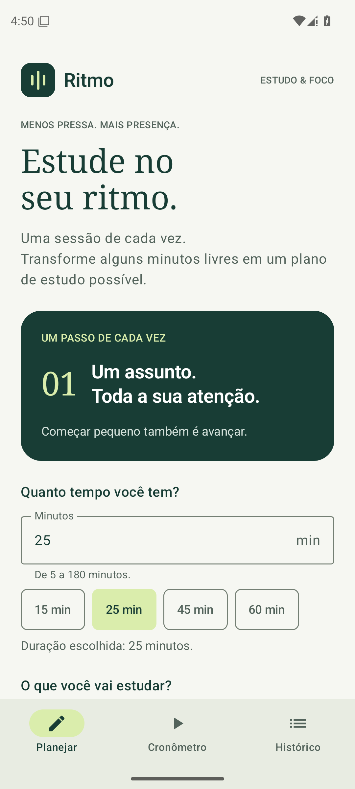

# SPEC-007 — Qualidade final do Ritmo

> **Team:** Team 09 
> **Sprint:** Sprint 07 
> **Status:** Validada 
> **Related Sprint:** [SPRINT-07.md](../../SPRINT-07.md)

## 1. Context

**Problema:** Ao longo de seis sprints, o Ritmo ganhou várias funções: tela inicial, escolha da duração, navegação para o plano, formulário com validação, histórico salvo no aparelho, aviso por notificação, cronômetro e meta da semana. Cada sprint foi validada de forma isolada. Falta confirmar que o produto inteiro funciona em conjunto, do momento em que o app abre até a sessão ser salva. 
**Usuários:** Estudantes universitários, incluindo alunos da UNEMAT. 
**Contexto:** Entrega final da disciplina. Esta SPEC **não** cria uma função nova: define os critérios de qualidade que o app completo precisa cumprir.

## 2. Objective

Garantir que o fluxo principal funcione a partir de uma abertura limpa, sem travamentos, com navegação, validação, persistência e integração se comportando como nas SPECs anteriores, e registrar as limitações conhecidas.

## 3. User Scenario

**Dado** que o estudante acabou de instalar o Ritmo e ainda não tem nenhuma sessão salva, 
**quando** abre o app, escolhe 40 minutos, informa o assunto “Cálculo I — limites”, abre o plano, começa o cronômetro, liga o aviso de fim, volta, abre o plano de novo e salva a sessão, 
**então** vê “1 sessão salva · 40 minutos no total”, a sessão no histórico e a meta da semana com 40 min, e o app não trava em nenhum momento.

## 4. Final Quality Requirements

### FR-01 — Abertura

O app abre direto na tela inicial, sem erro, mesmo sem dados salvos. A tela mostra a marca, a proposta, a duração, o formulário, o botão Planejar meu estudo e o histórico, com o estado vazio explicado.

### FR-02 — Navegação

Planejar meu estudo leva a Seu plano só com dados válidos. Voltar (na tela ou no Android) e Ajustar duração retornam à tela inicial com duração, assunto e objetivo preservados. Na tela inicial, o Voltar do Android sai do app.

### FR-03 — Validação de entrada

As regras VR-01 a VR-05 (SPEC-004 e SPEC-006) continuam valendo: mensagens visíveis abaixo do campo e o plano não abre com dados inválidos.

### FR-04 — Persistência

Salvar no histórico grava a sessão no Room (SPEC-005). O histórico e a meta da semana continuam iguais depois de recriar a tela e depois de fechar e abrir o app. A semana da meta vira na segunda-feira, mesmo com o app aberto.

### FR-05 — Estados da integração

O aviso de fim (SPEC-006) mostra os estados sem aviso, aviso marcado, aviso pausado e sem permissão. Sem permissão, o plano e o cronômetro continuam funcionando.

### FR-06 — Jornada sem travamento

O roteiro de regressão (seção 8) termina sem exceção e o log de travamentos do Android fica vazio durante toda a validação.

### FR-07 — Consistência visual e retorno ao usuário

Mesmas cores (Paper, Forest, Lime), cantos arredondados e termos em todas as telas (“sessão”, “plano”, “histórico”, “aviso”). Toda ação tem resposta visível: mensagem de erro, “Sessão salva no histórico.”, “Sessão excluída.” com Desfazer, “Aviso marcado para HH:mm.” Botões principais com pelo menos 48 dp de altura.

### FR-08 — Repositório limpo e reproduzível

Sem `.idea/`, `.gradle/`, `build/`, `local.properties`, chaves, tokens ou senhas. O Gradle Wrapper fica no repositório, e o README explica como compilar e executar.

## 5. Constraints

Kotlin, Jetpack Compose, Material 3, SDK mínimo 24 e compilação com SDK 35. Correções de última hora só com baixo risco: nenhuma tela foi redesenhada.

## 6. Out of Scope

Funções novas, login, sincronização em nuvem, edição de sessões e alarme exato.

## 7. Acceptance Criteria

| AC | Requisito | Condição |
| --- | --- | --- |
| AC-01 | — | SPEC-007 existe. |
| AC-02 | — | As SPEC-001 a SPEC-006 foram revisadas (tabela em SPRINT-07.md). |
| AC-03 | FR-01 | O fluxo principal funciona a partir da abertura limpa. |
| AC-04 | FR-02 | A navegação funciona. |
| AC-05 | FR-01 | A função de estado/interação funciona. |
| AC-06 | FR-03 | A validação do formulário funciona. |
| AC-07 | FR-04 | A persistência funciona como na SPEC-005. |
| AC-08 | FR-05 | A integração funciona ou falha de forma tratada, como na SPEC-006. |
| AC-09 | FR-06 | Nenhum travamento crítico no fluxo documentado. |
| AC-10 | — | `final-home.png`, `final-feature.png` e `final-validation.md` existem. |
| AC-11 | — | O README da equipe está completo. |
| AC-12 | FR-08 | Nenhum segredo ou pasta gerada no repositório. |
| AC-13 | — | Os requisitos principais podem ser rastreados até o código e a evidência. |
| AC-14 | — | Os dois integrantes conseguem explicar o projeto. |

## 8. Regression Script

Executado a partir de uma abertura limpa (dados do app apagados com `pm clear`):

| Passo | O que é verificado | SPEC |
| --- | --- | --- |
| RS-01 | O app abre na tela inicial. | 001 |
| RS-02 | A tela inicial é utilizável e o histórico vazio mostra a dica. | 001, 005 |
| RS-03 | O atalho 45 min fica marcado e o resumo muda na hora. | 002, 006 |
| RS-04 | Minutos “2” e assunto vazio mostram as mensagens e não abrem o plano. | 004, 006 |
| RS-05 | Dados válidos abrem Seu plano com duração, assunto e objetivo. | 003, 004 |
| RS-06 | Salvar no histórico grava a sessão; o total e a meta da semana somam os minutos; os dados continuam após recriar a tela e após fechar o app. | 005 |
| RS-07 | Cronômetro e aviso: Começar, Avisar quando acabar (marcado), Pausar (aviso pausado), Continuar (marcado de novo), Cancelar aviso; permissão negada mostra o estado alternativo. | 006 |
| RS-08 | Voltar do Android no plano volta à tela inicial com os dados preservados; na tela inicial, sai do app. | 003 |
| RS-09 | Nenhum travamento: jornada completa sem exceção e log de travamentos vazio. | 007 |

## 9. Traceability

| Requisito | Código | Teste / evidência |
| --- | --- | --- |
| Tela inicial (SPEC-001) | `ui/WelcomeScreen.kt` | `WelcomeTest`, `final-home.png` |
| Duração (SPEC-002, SPEC-006) | `ui/DurationPicker.kt`, `SessionRules.minutesError` | `DurationTest`, `SessionRulesTest` |
| Navegação (SPEC-003) | `ui/RitmoApp.kt` (`NavHost`) | `NavigationTest`, `clean-launch.txt` |
| Formulário (SPEC-004) | `ui/SessionForm.kt`, `model/SessionInput.kt` | `FormTest`, `SessionRulesTest` |
| Histórico (SPEC-005) | `data/` (Room), `ui/HistorySection.kt` | `HistoryTest`, `Sprint05Evidence`, `final-history.png` |
| Aviso e cronômetro (SPEC-006) | `reminder/`, `ui/ReminderCard.kt`, `ui/PlanScreen.kt`, `model/StudyTimer.kt` | `ReminderTest`, `TimerTest`, `Sprint06Evidence`, `final-feature.png` |
| Qualidade final (SPEC-007) | — | `FinalRegressionTest`, `crash-log.txt`, `final-validation.md` |

## 10. Validation Plan

1. Compilação, testes locais e lint (`assembleDebug testDebugUnitTest lintDebug`).
2. Todos os testes instrumentados, incluindo o novo `FinalRegressionTest.completeJourneyFromLaunch`, que segue os passos RS-01 a RS-09 em uma única jornada.
3. Abertura limpa e Voltar na tela raiz pelo `adb` (`clean-launch.txt`).
4. Todos os passos de evidência das sprints 04 a 07, cada um em um processo novo do app.
5. Log de travamentos do Android ao final (`crash-log.txt`).

## 11. Validation Results

Resultados em [final-validation.md](../../evidence/sprint-07/final-validation.md).

## 12. Evidence

## 13. Specification Status

- [x] Requisitos de qualidade final definidos.
- [x] Roteiro de regressão definido.
- [x] Rastreabilidade definida.
- [x] Implementação validada e evidências registradas.
