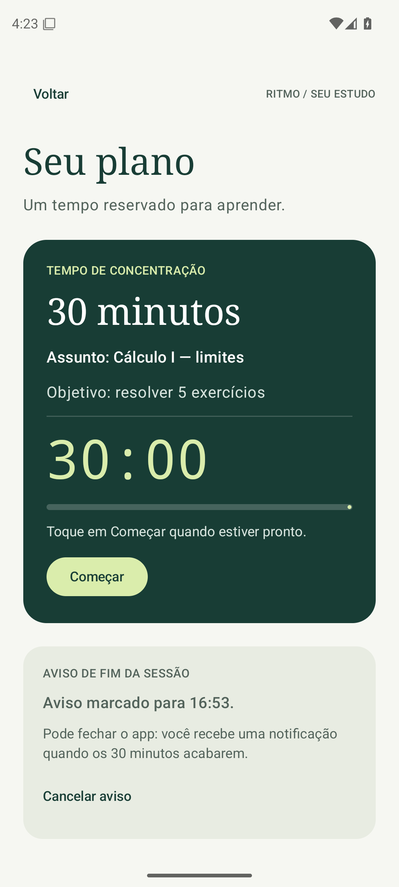
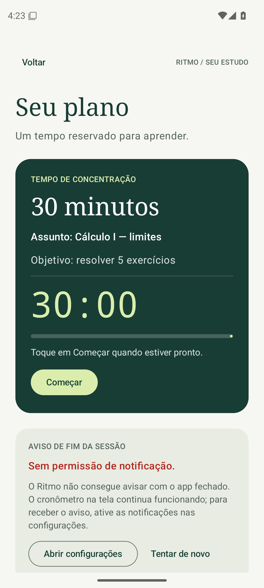
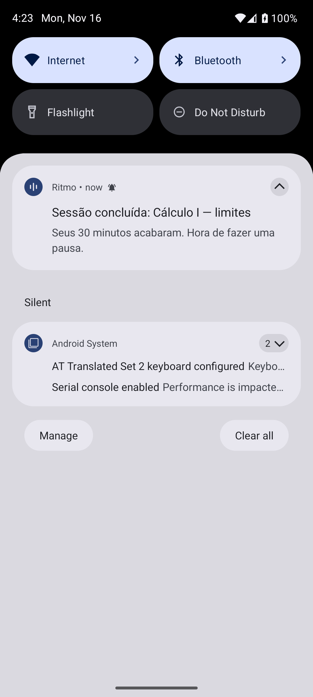
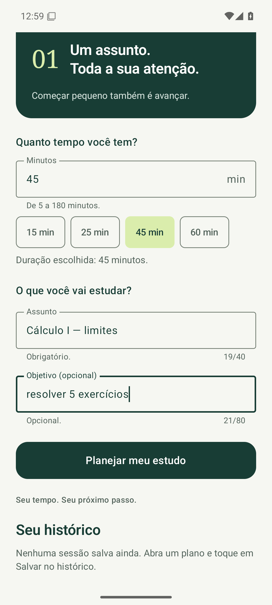
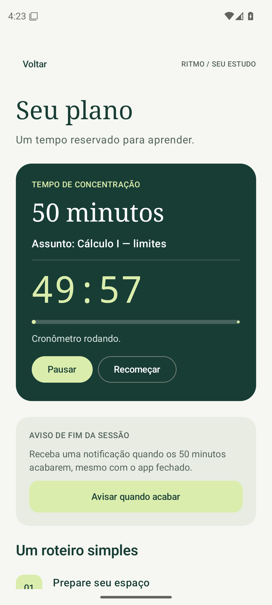
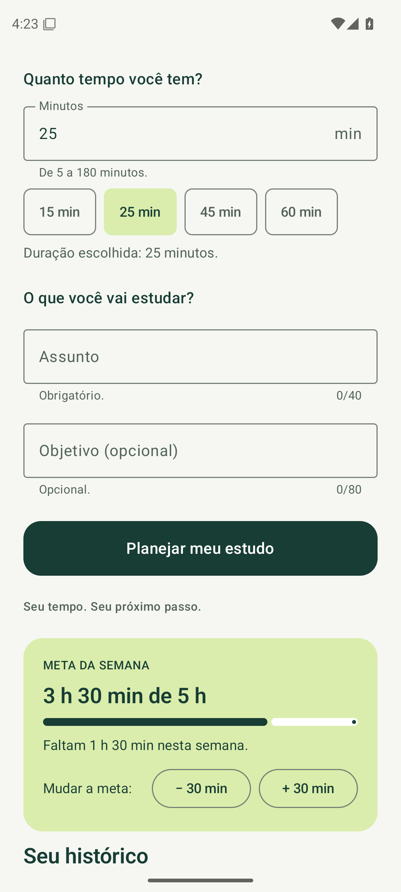
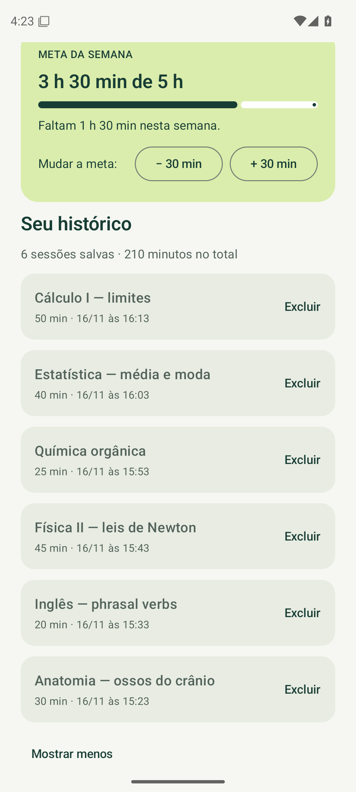
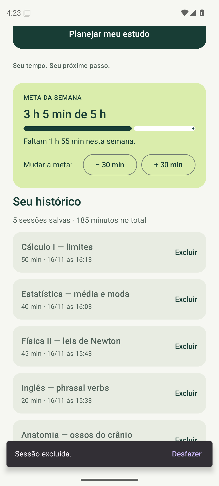

# Validação — Sprint 06

Validação realizada em 16/11/2026, em um emulador Pixel 6 com Android 15/API 35 (x86_64), executado pelo GitHub Actions (Ubuntu, KVM). Para as capturas, o fuso do emulador foi ajustado para America/Cuiaba ([device-date.txt](device-date.txt)).

Comandos, a partir de `app/`:

- `gradlew assembleDebug testDebugUnitTest lintDebug --console=plain`: **BUILD SUCCESSFUL** ([build-unit-lint.txt](build-unit-lint.txt))
- `gradlew connectedDebugAndroidTest --console=plain`: **BUILD SUCCESSFUL** ([instrumented-tests.txt](instrumented-tests.txt))

| Conjunto | Resultado |
| --- | --- |
| Testes locais | 17 aprovados, 0 falhas: `SessionRulesTest` 9 (3 novos para a regra VR-05), `StudyTimerTest` 5 e `WeeklyGoalTest` 3 ([unit-tests.xml](unit-tests.xml)) |
| Testes instrumentados | 31 aprovados, 0 falhas; 8 testes de evidência ignorados nessa execução, conforme previsto ([instrumented-tests.xml](instrumented-tests.xml)) |
| Lint | 0 erros e 21 avisos ([lint.txt](lint.txt)) |

Testes instrumentados por classe: `FormTest` 7, `HistoryTest` 7, `DurationTest` 5 (reescrito para a duração digitada), `NavigationTest` 4, `ReminderTest` 4, `TimerTest` 3 e `WelcomeTest` 1.

## Cenários da integração

Antes de cada passo de evidência, o script retira a permissão de notificação do app (`pm revoke` e `pm clear-permission-flags`). Assim, a janela de permissão do sistema aparece de verdade e é respondida pelo UiAutomator ([evidence-run.txt](evidence-run.txt)).

| Cenário | Passo | Resultado |
| --- | --- | --- |
| Alternativo: permissão negada | `Sprint06Evidence#notificationDenied` toca em **Não permitir** | O cartão mostra “Sem permissão de notificação.”, com a explicação, Abrir configurações e Tentar de novo ([integration-alternative-state.png](integration-alternative-state.png)) |
| Sucesso: permissão concedida | `Sprint06Evidence#notificationAllowed` toca em **Permitir** | “Aviso marcado para 16:53.” (30 min depois do horário do emulador) e Cancelar aviso ([integration-success.png](integration-success.png)) |
| Sucesso: notificação | No mesmo passo, o `SessionEndWorker` é executado sem esperar os 30 minutos | A gaveta mostra “Sessão concluída: Cálculo I — limites” / “Seus 30 minutos acabaram. Hora de fazer uma pausa.” ([integration-notification.png](integration-notification.png)) |

## Melhorias de uso

| Cenário | Verificação | Resultado |
| --- | --- | --- |
| Cronômetro | `TimerTest`: começa no tempo digitado; Começar, Pausar (o tempo para), Continuar e Recomeçar; continua rodando após recriar a tela. `ImprovementsEvidence#timer` | PASS ([timer-running.png](timer-running.png)) |
| Aviso acompanha o cronômetro | `ReminderTest.reminderFollowsTheTimer`: pausar deixa o trabalho `CANCELLED` e mostra “Aviso pausado junto com o cronômetro.”; continuar volta a `ENQUEUED` | PASS |
| Meta da semana | `HistoryTest.weeklyGoalCountsSavedMinutesAndCanBeChanged`: soma a sessão salva, +30/−30 min, meta mantida após recriar a tela. `ImprovementsEvidence#history` | PASS ([weekly-goal.png](weekly-goal.png)) |
| Excluir com Desfazer | `HistoryTest.deleteRemovesTheSessionAndUndoBringsItBack` | PASS ([history-deleted.png](history-deleted.png)) |
| Ver todas | `HistoryTest.homeReadsDatabaseNewestFirstLimitedToFive`: 5 visíveis, Ver todas mostra a 6ª, Mostrar menos volta às 5 | PASS ([history-all.png](history-all.png)) |

O atraso de N minutos é de responsabilidade do WorkManager. O teste `ReminderTest.reminderIsScheduledAndCanBeCancelled` confere que o trabalho fica `ENQUEUED` depois do toque e `CANCELLED` depois de Cancelar aviso.

| Critério da SPEC | Resultado | Como foi verificado |
| --- | --- | --- |
| AC-01 | PASS | [SPEC-006](../../docs/specs/SPEC-006.md). |
| AC-02 | PASS | O aviso marca o fim da sessão planejada, com o assunto e a duração do plano. |
| AC-03 | PASS | `ReminderTest.reminderIsScheduledAndCanBeCancelled`; passos de evidência. |
| AC-04 | PASS | `reminderIsScheduledAndCanBeCancelled`, `workerPostsTheEndOfSessionNotification`, `schedulingAgainReplacesThePreviousReminder`; `integration-success.png` e `integration-notification.png`. |
| AC-05 | PASS | `Sprint06Evidence#notificationDenied`; `integration-alternative-state.png`. |
| AC-06 | PASS | Nenhuma chave, token ou senha: a integração não usa serviço externo. |
| AC-07 | PASS | `FormTest`, `HistoryTest`, `NavigationTest`, `WelcomeTest` e os passos das sprints 04 e 05 aprovados; `DurationTest.typedDurationIsUsedInThePlan`. |
| AC-08 | PASS | Compilação, testes e lint aprovados. |
| AC-09 | PASS | Capturas nesta pasta. |
| AC-10 | PASS | Fluxo descrito na SPEC-006 (seção 9) e em SPRINT-06.md. |

## Observações

- Na primeira versão, o cartão do aviso ficava abaixo do roteiro, na mesma altura do botão Planejar meu estudo da tela anterior. O teste de toque duplo (`NavigationTest.rapidForwardTapsDoNotDuplicateTheDestination`) mostrou que o segundo toque caía em Avisar quando acabar e abria a janela de permissão sem querer. O cartão foi movido para logo abaixo do tempo da sessão.
- Em uma das execuções, uma janela de erro do sistema do emulador tirou o foco do app e derrubou vários testes. O script passou a esconder essas janelas (`hide_error_dialogs`) antes dos testes.
- Nas melhorias, dois testes novos falharam na primeira execução porque a mensagem “Sessão salva no histórico.” cobria o botão tocado no fim da tela. Os testes passaram a esperar a mensagem sumir antes de tocar.
- A tela do plano agora ignora toques durante a animação de entrada, o que elimina a causa do toque duplo descrito acima.
- Lint: os avisos são, em sua maioria, versões mais novas de bibliotecas (mantidas por compatibilidade com o Kotlin 2.1.20). O aviso `ObsoleteSdkInt` em `ReminderCard.kt` é um falso positivo: a verificação de versão é necessária, porque o `minSdk` é 24.

## Capturas

